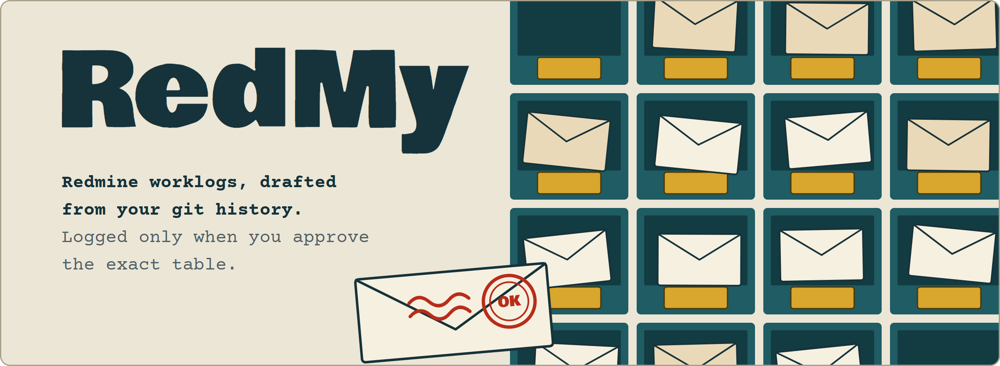
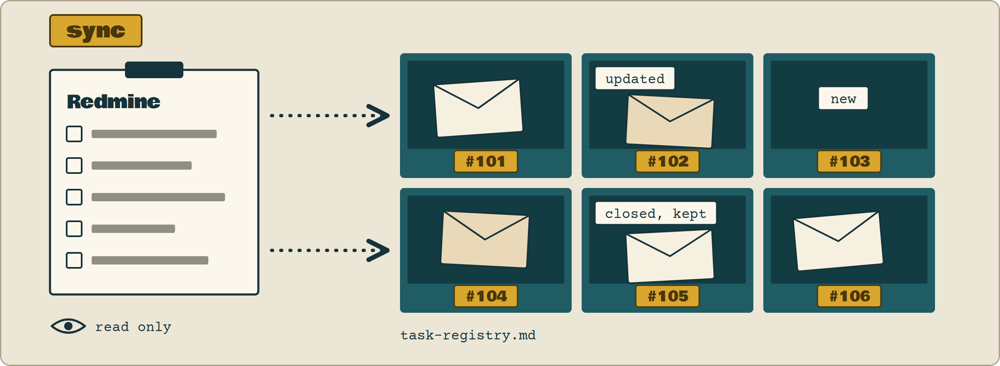
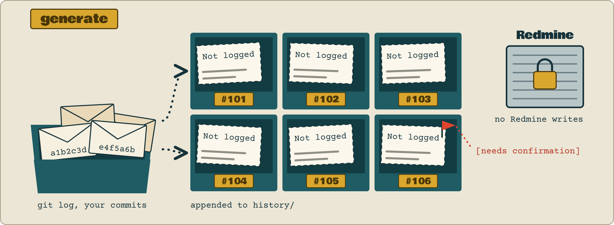
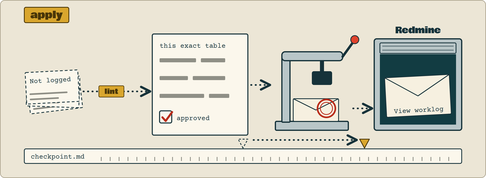

<h1 align="center"><picture><source media="(prefers-color-scheme: dark)" srcset="assets/redmy-hero-dark.webp"></picture></h1>

<p align="center"><b>Your commits already know what you did. RedMy turns them into Redmine worklogs, and posts nothing until you say so.</b></p>

<p align="center"><a href="#how-a-cycle-runs">How it works</a> &middot; <a href="#get-started">Get started</a> &middot; <a href="#reference">Reference</a></p>

Redmine wants hours, per issue, per day. Your git history already shows what you worked on. Bridging the two by hand is a chore, and a wrong entry lands in your official work-hour records.

RedMy is a set of agent skills that does the bridging. It keeps your issue list in step with Redmine, drafts worklog rows from your commits, and logs them only after you approve the exact table.

RedMy is for you if you log time against Redmine issues assigned to you, your work lives in git repositories you can map to those issues, and you want to read the table before anything is logged.

## How a cycle runs

<picture><source media="(prefers-color-scheme: dark)" srcset="assets/redmy-flow-dark.webp"></picture>

Run `redmy-generate` when you have work that is not logged yet. It refreshes the registry first if it is stale, drafts the rows, and points you to `redmy-apply`, where you read the table, approve it, and the rows are logged.

## One rule: nothing is logged until you approve

Drafting only touches files in your project, so RedMy does it freely. Writing to Redmine changes your official records, so it asks. The approval gate is modeled on the approval step of `terraform apply`: nothing is written until a person has seen the exact request.

- Only `redmy-apply` is allowed to write to Redmine. `redmy-sync` and `redmy-generate` never do.
- You approve the exact table you are shown. Approval does not carry over to the next cycle, to another issue, or to a table you edited afterwards.
- A row that rests on a judgment call carries `[needs confirmation]`, and thin evidence is never padded with invented hours: it asks you instead.
- If a row fails to log, it stops and reports. It does not retry or look for a way around.

## Meet the skills

### `redmy-sync`: keep the registry honest

<picture><source media="(prefers-color-scheme: dark)" srcset="assets/redmy-sync-dark.webp"></picture>

It reads the issues assigned to you from Redmine and updates `task-registry.md`: new issues become rows, changed subjects and statuses are updated in place, closed issues stay in the table with their status updated, and the cached hours get a refresh date. It never writes to Redmine, so it is safe to run any time.

### `redmy-generate`: sort your commits into drafts

<picture><source media="(prefers-color-scheme: dark)" srcset="assets/redmy-generate-dark.webp"></picture>

For each issue with a gap since its checkpoint date, it reads `git log` of the repos mapped to that issue, filtered to your commits, and drafts one row per working day into `history/<issue-id>-<slug>.md`. Each row has `Worklog` set to `Not logged` and a commit SHA as evidence (or a note that you reported the work yourself). It never calls the Redmine time-logging API.

### `redmy-apply`: log only what you approved

<picture><source media="(prefers-color-scheme: dark)" srcset="assets/redmy-apply-dark.webp"></picture>

It lints the draft rows, shows you the whole table with the hours per issue, and calls `smart_log_time` only after you approve that exact table. Each logged row gets a worklog link in place of `Not logged`, and `checkpoint.md` moves to the latest row that was actually logged.

## Get started

1. Install the skills with [`npx skills`](https://skills.sh):

   ```
   npx skills add the-khiem7/RedMy --skill redmy-sync
   npx skills add the-khiem7/RedMy --skill redmy-generate
   npx skills add the-khiem7/RedMy --skill redmy-apply
   ```

   Or install every skill in the repo at once with `npx skills add the-khiem7/RedMy --all`.

2. Give your project the files the skills read. The [data contract](#data-contract-these-skills-expect-in-the-installing-project) lists them, and this repo does not ship templates for them yet.
3. Ask your agent to run `redmy-generate`, and read the draft table it shows.
4. Ask your agent to run `redmy-apply`, and approve the table to log it.

## Requirements

- An agent that supports skills, with a Redmine MCP server that provides the tools the skills call: `get_current_user`, `list_issues`, `get_issue` and `list_projects` to read, and `smart_log_time` to log (only `redmy-apply` may call it).
- `git`, and the repos mapped to your issues in `task-registry.md`.
- The project files described in the data contract, and the base URL of your Redmine.

## Reference

### Data contract these skills expect in the installing project

These skills are process logic only and ship no Redmine data. The project they are installed into must provide the files below. The only file a skill creates is `history/<issue-id>-<slug>.md`: `redmy-generate` creates it the first time an issue has real work hours.

<picture><source media="(prefers-color-scheme: dark)" srcset="assets/redmy-contract-dark.webp"></picture>

<details>
<summary>The data contract as a table</summary>

| File | What it holds | Touched by |
|---|---|---|
| `task-registry.md` | one row per Redmine issue or epic: ID, project, subject, status, repo path mapping, a Constraints column | `redmy-sync` reads and writes; `redmy-generate` reads |
| `checkpoint.md` | one row per issue: last logged date and hours, the resume pointer | `redmy-generate` reads; `redmy-apply` writes |
| `git-identity-map.md` | repo path to the git author name or names that are you, per repo | `redmy-generate` reads and adds rows |
| `decisions.md` | durable log of one-off resolved ambiguities, one `RW-D<n>` entry each (`RW-D1`, `RW-D2`, ...) | `redmy-sync` writes; `redmy-generate` reads and writes |
| `history/<issue-id>-<slug>.md` | one append-only worklog table per issue: Date, Hours, Activity, Redmine Comment, Worklog, Evidence | `redmy-generate` appends; `redmy-apply` reads and updates |
| Redmine base URL, `<REDMINE_BASE_URL>` | the root URL of your Redmine instance | `redmy-apply` builds the worklog link from it |

</details>

The column names in the table are the ones the skills read. A reference implementation of this data contract lives in the original working repo this was extracted from (not part of this skills repo). The known gaps are tracked in [docs/baseline/redmy/](docs/baseline/redmy/redmy.roadmap.md).

<details>
<summary>Drafting rules <code>redmy-generate</code> follows</summary>

- A working day is balanced to about 8 hours, Monday to Friday. Weekend or leave days count hours only when you confirm them.
- Hours are never padded when the evidence is thin: it reads the full diff and neighbouring commits, and asks you if that is still not enough.
- The Redmine comment is one short sentence in plain technical terms, with no internal report names, release branch names or tool names.
- When it is unclear which issue a commit belongs to, it looks the issue up in Redmine before guessing, and records the answer in `decisions.md`.
- Only commits at the level of the repo listed for the issue count. The history inside a git submodule is not used to judge the size of your work.
- A row where the issue or the hours are a judgment call carries `[needs confirmation]`.

</details>

<details>
<summary>The approval gate and the lint checks in <code>redmy-apply</code></summary>

- Approval is per request. It does not carry over to the next generate cycle, to another issue, or to a table edited after you approved it.
- If a row cannot be logged (a permission or API error), it reports the situation and waits for you. It does not retry or look for another way around. A row you skip is marked `**Skipped**` and does not count toward the checkpoint.
- Before the table is shown, each Redmine comment is linted: one short sentence (no more than about 160 characters and one semicolon), no internal terms such as report file names or release branch names, the `[needs confirmation]` label kept as it is, and a non-empty Evidence column.
- A row that fails lint is shown as failed. The skill does not rewrite it and log it.

</details>
